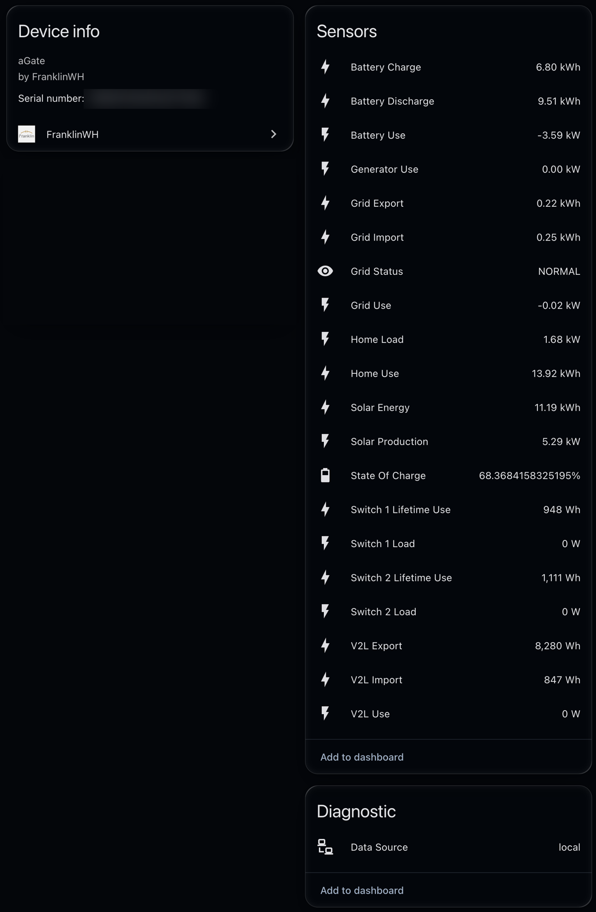
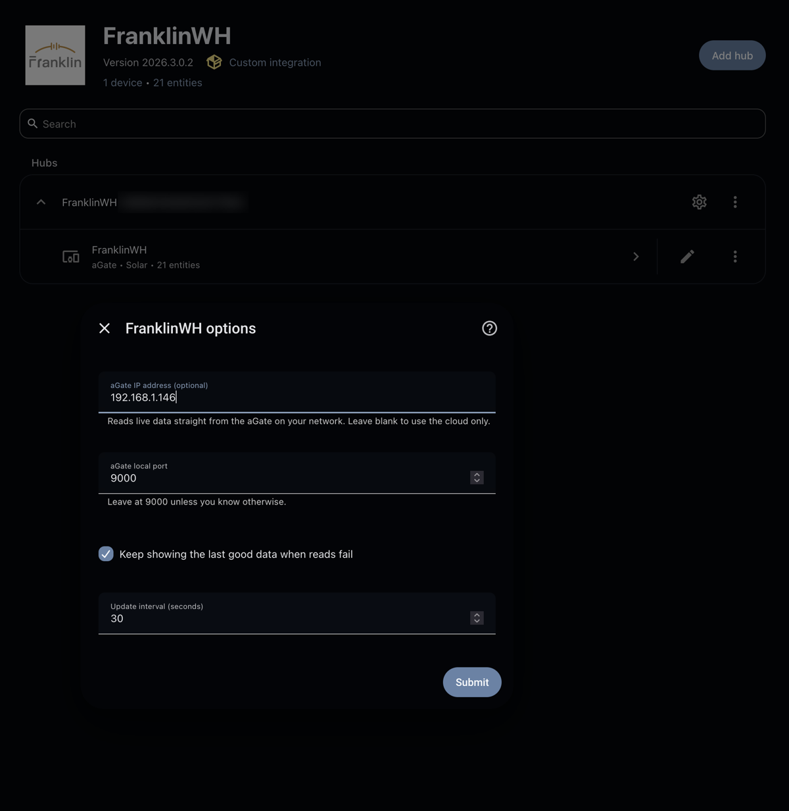

# FranklinWH Integration for Home Assistant (local-first fork)

[](https://github.com/hacs/integration)

A custom integration for [Home Assistant](https://www.home-assistant.io/) that monitors FranklinWH home energy storage systems.

This is a fork of [richo/homeassistant-franklinwh](https://github.com/richo/homeassistant-franklinwh). It adds two things:

- **Local data from the aGate.** Live readings come straight from the aGate on your home network, so Home Assistant keeps updating when the FranklinWH cloud feed stalls (the same stalls that freeze the FranklinWH app).
- **UI setup.** Add FranklinWH from **Settings → Devices & services** instead of YAML. All its sensors then appear on one **FranklinWH aGate** device page.

Everything from the original still works, including YAML setup.

> ⚠️ This project is unofficial and not affiliated with FranklinWH. The aGate's local protocol is undocumented, so a FranklinWH firmware update could change or close it. If that happens, the integration falls back to the cloud automatically.

<p align="center"></p>

---

## What's new in this fork

| Change | Details |
|---|---|
| Local-first data | With an aGate IP set, battery %, solar, home load, grid and battery power, generator, grid status and the daily kWh totals are read directly from the aGate (TCP port 9000). |
| Cloud fallback | If the aGate can't be reached, the integration reads everything from the cloud as before. |
| Data Source sensor | A new diagnostic sensor shows where the latest data came from: `local`, `cloud` or `stale` (cached). |
| UI setup | Add the integration from the UI. The form checks your login and that the aGate answers before saving. |
| Device page | Sensors set up from the UI belong to a single **FranklinWH aGate** device. |
| Configure button | Change the aGate IP, port, update interval or stale-data setting later without editing YAML. |
| YAML `host` / `port` | YAML users can turn on local data with `host:` too. |

### What still uses the cloud

- **Smart Circuit (switch 1/2) and V2L sensors.** The aGate doesn't include these in its local data, so they're still fetched from the cloud on each update. During a cloud outage only these sensors go blank; everything else keeps updating.
- **Smart Circuit on/off switches.** These are still YAML-only and still controlled through the cloud.
- **The fallback**, if the aGate can't be reached.

Your FranklinWH login is therefore still required.

### How local data matches the cloud

The cloud's live data is the aGate's own power-flow report, relayed. Reading it locally gives the same values with the same meaning:

- Power is converted from the aGate's watts to kW, matching the cloud sensors.
- The kWh totals are daily totals since local midnight, as with the cloud, so switching between local and cloud doesn't create spikes in the Energy dashboard.
- Signs follow the aGate: battery power is negative while charging, and grid power is negative while exporting.

---

## Requirements

- A FranklinWH aGate on the same network as Home Assistant, ideally with a fixed IP (a DHCP reservation in your router).
- Your FranklinWH app login.
- Your gateway serial number. In the FranklinWH app: **Settings → Device Info → SN**.

To check that your aGate accepts local connections, run this on a Mac or Linux machine on the same network (replace the IP with yours):

```bash
nc -vz -w 3 192.168.1.146 9000
```

`succeeded` means local data will work. On Windows, use `Test-NetConnection 192.168.1.146 -Port 9000` in PowerShell and look for `TcpTestSucceeded : True`.

Modbus (port 502) does **not** need to be enabled.

---

## Installation

### Via HACS

1. In Home Assistant, go to **HACS**.
2. Click the menu (⋮) → **Custom repositories**.
3. Add `https://github.com/tdiggity/homeassistant-franklinwh` with category **Integration**.
4. Find **FranklinWH** in HACS and click **Download**.
5. Restart Home Assistant.

If you previously installed richo's version through HACS, remove it in HACS first and delete its entry under **Custom repositories**. Both versions install to the same `custom_components/franklin_wh` folder.

### Manual

1. Download this repository as a ZIP.
2. Extract it to your Home Assistant `custom_components/franklin_wh/` directory.
3. Restart Home Assistant.

---

## Setup from the UI (recommended)

1. Go to **Settings → Devices & services → Add integration**.
2. Search for **FranklinWH**.
3. Fill in the form:

| Field | What to enter |
|---|---|
| Email / Password | Your FranklinWH app login |
| Gateway serial number | From the FranklinWH app: Settings → Device Info → SN |
| aGate IP address | Your aGate's IP, e.g. `192.168.1.146`. Leave blank to use the cloud only. |
| aGate local port | Leave at `9000` |
| Keep showing the last good data when reads fail | Recommended. Smooths graphs when a read fails. |
| Update interval | Seconds between updates. Default 30. |

Before saving, the form checks that the aGate answers at the IP you gave and that the FranklinWH cloud accepts your login. If the cloud happens to be down but the aGate answers, setup still goes ahead.

To change the aGate IP or other settings later, open the integration and click **Configure**.

<p align="center"></p>

### Moving from YAML to UI setup

Do these steps in this order to keep your entity IDs, and with them your history, dashboards and automations:

1. Update the integration in HACS (**FranklinWH → ⋮ → Redownload**).
2. Remove the `platform: franklin_wh` entry from the `sensor:` section of `configuration.yaml`. Keep any `switch:` entries; switches are still YAML-only.
3. Restart Home Assistant. The old sensors disappear; this is expected.
4. Add FranklinWH from the UI as described above.

The new sensors take the same entity IDs as before (`sensor.franklinwh_state_of_charge` and so on). If you add the UI integration while the YAML sensors are still loaded, the new ones get a `_2` suffix instead.

---

## Setup with YAML

YAML setup still works. Store your password in `secrets.yaml` rather than writing it into the config.

```yaml
sensor:
  - platform: franklin_wh
    username: "email@domain.com"
    password: !secret franklinwh_password
    id: "100xxxxxxxxxxxx"
    host: 192.168.1.146      # optional: read live data from the aGate
    tolerate_stale_data: true
```

Leave out `host` to use the cloud only, exactly like the original integration.

YAML-configured sensors don't get a device page; that needs UI setup.

`tolerate_stale_data` is not required, but is recommended. The FranklinWH cloud often fails to return valid data, and this flag keeps the last good data until fresh data arrives, which smooths out the graphs. If accuracy matters more to you than smooth graphs, leave it off.

### Smart Relays

The integration can also control Smart Circuit relays, if they're installed in your gateway. These are configured in YAML only. Don't enable this unless the relays are physically installed, and make sure the configuration matches your installation.

FranklinWH supports combining relays, which is why the `switches` parameter is a list: if several switches are ganged together, include all of their indexes.

```yaml
switch:
  - platform: franklin_wh
    username: "email@domain.com"
    password: !secret franklinwh_password
    id: "100xxxxxxxxxxxx"
    switches: [3]
    name: "FWH switch1"

  - platform: franklin_wh
    username: "email@domain.com"
    password: !secret franklinwh_password
    id: "100xxxxxxxxxxxx"
    switches: [1, 2]
    name: "FWH switch2"
```

Restart Home Assistant after changing your configuration.

### YAML options

| Option | Type | Description | sensor | switch |
|---|---|---|:---:|:---:|
| `host` | string | aGate IP address. Turns on local data. | ✅ | |
| `port` | int | aGate local port. Default `9000`. | ✅ | |
| `use_sn` | bool | Use the gateway's SN to give entities unique IDs | ✅ | ✅ |
| `prefix` | string | Prefix used in entity names. Default `FranklinWH`. | ✅ | ✅ |
| `update_interval` | time | How often to update. Default 30s. | ✅ | ✅ |
| `tolerate_stale_data` | bool | Keep showing the last good data instead of going unavailable when a read fails | ✅ | |

---

## Available entities

| Entity name | Description | Unit | Source with an aGate IP set |
|---|---|---|---|
| FranklinWH State of Charge | Battery state of charge | % | Local |
| FranklinWH Battery Use | Battery charging/discharging rate | kW | Local |
| FranklinWH Battery Charge | Energy charged to battery today | kWh | Local |
| FranklinWH Battery Discharge | Energy discharged from battery today | kWh | Local |
| FranklinWH Home Load | Instantaneous home power use | kW | Local |
| FranklinWH Home Use | Energy consumed by home today | kWh | Local |
| FranklinWH Grid Use | Net grid power | kW | Local |
| FranklinWH Grid Status | Grid connection state | — | Local |
| FranklinWH Grid Import | Energy imported from grid today | kWh | Local |
| FranklinWH Grid Export | Energy exported to grid today | kWh | Local |
| FranklinWH Solar Production | Instantaneous solar power | kW | Local |
| FranklinWH Solar Energy | Solar energy produced today | kWh | Local |
| FranklinWH Generator Use | Generator power output | kW | Local |
| FranklinWH Switch 1 Load | Power draw on Switch 1 | W | Cloud |
| FranklinWH Switch 1 Lifetime Use | Energy used by Switch 1 | Wh | Cloud |
| FranklinWH Switch 2 Load | Power draw on Switch 2 | W | Cloud |
| FranklinWH Switch 2 Lifetime Use | Energy used by Switch 2 | Wh | Cloud |
| FranklinWH V2L Use | Power use via Vehicle-to-Load | W | Cloud |
| FranklinWH V2L Import | Energy drawn from V2L | Wh | Cloud |
| FranklinWH V2L Export | Energy delivered to V2L | Wh | Cloud |
| FranklinWH Data Source | Where the latest data came from: `local`, `cloud` or `stale` | — | — |

Without an aGate IP, every sensor comes from the cloud, as in the original integration.

---

## Flipping sensors

If you want to reverse a sensor's sign, create a template sensor:

```yaml
  - sensor:
    - name: corrected_battery_use
      state: >
        {{ -(states('sensor.franklinwh_battery_use') | float) }}
      unit_of_measurement: kW
      state_class: measurement
      device_class: power
  - sensor:
    - name: corrected_grid_use
      state: >
        {{ -(states('sensor.franklinwh_grid_use') | float) }}
      unit_of_measurement: kW
      state_class: measurement
      device_class: power
```

---

## Troubleshooting

- **Data Source shows `cloud` when you expected `local`.** The aGate didn't answer. Check its IP (it may have changed if it isn't reserved in your router) and test port 9000 as shown under Requirements. Then update the IP with **Configure**, or with `host:` in YAML.
- **Smart Circuit or V2L sensors are blank** while everything else updates. The FranklinWH cloud is down; these come only from the cloud.
- **No entities appear.** Check your login and gateway serial number, and that the FranklinWH cloud is online if you haven't set an aGate IP.
- **`'host' is an invalid option`** in the YAML config check. Home Assistant is still running the old version of the integration. Restart after downloading the update, then check again.
- **Logs.** Go to **Settings → System → Logs** and search for `franklin`.

---

## Credits

- [richo/homeassistant-franklinwh](https://github.com/richo/homeassistant-franklinwh), the original integration this fork builds on.
- [david2069/franklinwh-local](https://github.com/david2069/franklinwh-local) (`franklinwh-direct-connect-api`), the library that talks to the aGate locally.
- [mtnears/FranklinWH-Automation](https://github.com/mtnears/FranklinWH-Automation), whose local-gateway work showed the approach.

## License

This project is dual-licensed under the MIT License and the Apache License 2.0. You may choose either license when using or contributing to this project.
